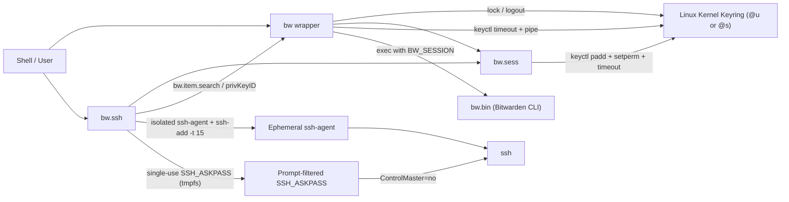

# bw_scripts

Bash scripts that extend the Bitwarden CLI (`bw`) with Linux kernel keyring sessions, vault item queries, SSH authentication, and Linux host provisioning.

## Overview

The `bw` wrapper intercepts Bitwarden CLI commands and stores the session key in the Linux kernel keyring (`@u` by default, or `@s` via `BW_KEYRING`).
All terminals in the same keyring share one session key.
Each `bw` call resets the keyring timeout so the vault locks automatically after inactivity.



## Prerequisites

Install these tools on your local Linux host before you run the scripts:

| Tool | Purpose |
| --- | --- |
| `bash` | Runs all scripts. |
| `bw.bin` | Official Bitwarden CLI binary, renamed from `bw`. |
| `keyctl` | Manages session keys in the Linux kernel keyring (`@u` or `@s`). Provided by `keyutils`. |
| `jq` | Parses and builds Bitwarden item JSON. |
| `ssh`, `ssh-add`, `ssh-agent`, `ssh-keygen` | OpenSSH client tools for `bw.ssh` and `bw.keysetup`. |
| `perl` | Generates Yescrypt (`$y$j9T$`) password hashes in `bw.keysetup`. |

> [!IMPORTANT]
> Rename the official Bitwarden CLI binary from `bw` to `bw.bin` before you install these scripts.
> The `bw` wrapper expects `bw.bin` in `PATH` and replaces `bw` as your entry point.

```bash
bw_path="$(command -v bw)"
mv "${bw_path}" "$(dirname "${bw_path}")/bw.bin"
```

Runtime environment requirements:

- A Linux kernel with user (`@u`) or session (`@s`) keyring support.
- A writable `tmpfs` or `ramfs` directory (`$XDG_RUNTIME_DIR`, `/run/user/<uid>`, or `/dev/shm`) for temporary files in `bw.ssh` and `bw.keysetup`.
- `shellcheck` (optional) for static analysis during test runs.

## Installation

### Installer Script (Recommended)

Run `install.sh` to check all required host tools and install all 11 scripts with mode `0755`.
By default, `install.sh` installs scripts into `~/.local/bin`.

```bash
git clone https://github.com/neoautomata/bw_scripts.git
cd bw_scripts

# Check host prerequisites without installing files
./install.sh --check-only

# Install into ~/.local/bin
./install.sh

# Or install into a custom directory
./install.sh --prefix /usr/local/bin
```

| Option | Behavior |
| --- | --- |
| `--prefix <dir>`, `--prefix=<dir>` | Installs scripts into `<dir>`. Rejects empty values, leading `-`, and symlinks. Default: `~/.local/bin`. |
| `--check-only` | Checks all required host tools and exits without copying files. |
| `--help`, `-h` | Prints usage text and exits with code `0`. |

Add the target directory to `PATH` if your shell does not already include it:

```bash
export PATH="${HOME}/.local/bin:${PATH}"
```

### Manual Installation

Copy the 11 scripts into any directory in `PATH` and mark them executable:

```bash
chmod +x bw bw.sess bw.item.* bw.ssh bw.keysetup
cp bw bw.sess bw.item.* bw.ssh bw.keysetup "${HOME}/.local/bin/"
```

## Configuration

| Environment Variable | Default | Description |
| --- | --- | --- |
| `BW_SESSION_TIMEOUT` | `900` | Sliding keyring timeout in seconds for `bw_session`. Accepts an integer from `1` to `86400`. `bw` and `bw.sess` exit `1` for invalid values. |
| `BW_KEYRING` | `@u` | Target Linux kernel keyring. Accepts `@u` (user keyring) or `@s` (session keyring). `bw` and `bw.sess` exit `1` for other values. |
| `XDG_RUNTIME_DIR` | `/run/user/<uid>` | RAM-backed directory for temporary `SSH_ASKPASS` and `ssh-keygen` files. Scripts check `$XDG_RUNTIME_DIR` (or `/run/user/<uid>`), then `/dev/shm`. Each candidate must be a non-symlink `tmpfs` or `ramfs` directory. |

> [!NOTE]
> `bw.sess` runs `bw.bin sync` automatically when the last vault sync is older than 8 hours.

## Script Reference

### Session and Wrapper Scripts

| Script | Usage | Description |
| --- | --- | --- |
| `bw` | `bw [bw-args...]` | Manages `bw_session` in `BW_KEYRING`, resets the timeout, exports `BW_SESSION`, and runs `bw.bin`. Revokes and unlinks the key on `lock` or `logout`. Bypasses `bw.sess` for metadata and auth commands (`--help`, `-h`, `--version`, `-v`, `help`, `login`, `unlock`, `status`, `config`). Rejects `bw serve` to prevent persistent `BW_SESSION` exposure. |
| `bw.sess` | `bw.sess` | Checks an existing keyring session key or unlocks the vault. Revokes stale keys on failed `unlock --check`. Sets possessor-only permissions (`0x3f000000`), sets the timeout, and syncs if stale. Exits `2` on unlock failure. |

### Item Query Scripts

All `bw.item.*` scripts that accept `<itemID>` require a valid UUID and exit `1` otherwise.

| Script | Usage | Description |
| --- | --- | --- |
| `bw.item.get` | `bw.item.get <itemID>` | Prints the full JSON object for `<itemID>`. |
| `bw.item.search` | `bw.item.search <search>` | Searches active vault items (`deletedDate == null`) for an exact `.name` match and prints the single matching item ID. |
| `bw.item.pass` | `bw.item.pass <itemID>` | Prints the raw password for `<itemID>`. |
| `bw.item.field` | `bw.item.field <itemID> <fieldName>` | Prints the value of the single custom field named `<fieldName>`. |
| `bw.item.attachmentID` | `bw.item.attachmentID <itemID> (--exact <name> \| --prefix <prefix> [--suffix <suffix> \| --exclude-suffix <suffix>]) [--label <label>]` | Matches attachments with parameterized `jq` filters and prints the single matching attachment ID. |
| `bw.item.privKeyID` | `bw.item.privKeyID <itemID> <keyPrefix>` | Finds the single attachment whose filename starts with `<keyPrefix>` and does not end with `.pub`. |
| `bw.item.pubKeyID` | `bw.item.pubKeyID <itemID> <keyPrefix>` | Finds the single attachment whose filename starts with `<keyPrefix>` and ends with `.pub`. |

### SSH, Provisioning, and Installer Scripts

| Script | Usage | Description |
| --- | --- | --- |
| `bw.ssh` | `bw.ssh <ssh-options> <destination> [command]` | Resolves `<user>@<host>` with `ssh -G`. Starts an isolated `ssh-agent` with a 15-second key TTL, or uses single-use `SSH_ASKPASS` when no key exists. |
| `bw.keysetup` | `bw.keysetup <ssh-options> root@<host>` | Provisions `root` and `jumper` Bitwarden items, Yescrypt passwords, `ed25519` SSH keys, `authorized_keys`, and `PermitRootLogin prohibit-password`. |
| `install.sh` | `install.sh [--prefix <dir>] [--check-only] [--help]` | Checks host tools, rejects symlinks, and atomically installs all 11 scripts with mode `0755`. |

### Query Exit-Code Contract

`bw.item.search`, `bw.item.field`, `bw.item.attachmentID`, `bw.item.privKeyID`, and `bw.item.pubKeyID` return deterministic exit codes so callers fail closed:

| Exit Code | Meaning |
| --- | --- |
| `0` | Found 1 match and printed the result to stdout. |
| `1` | Usage error, invalid UUID, missing tool, Bitwarden error, `jq` error, or empty ID. |
| `2` | Found 0 matches. |
| `3` | Found more than 1 match (ambiguous result). |

## Usage Examples

### Run Bitwarden CLI Commands

Use `bw` directly without exporting `BW_SESSION` manually:

```bash
bw list items --search "GitHub"

# Revoke and unlink the cached keyring session
bw lock
```

### Query Vault Items, Fields, and Attachments

```bash
# Find an item ID by exact item name
item_id="$(bw.item.search "Cloudflare")"

# Read a custom field
bw.item.field "${item_id}" "api_key"

# Read the login password
bw.item.pass "${item_id}"

# Find an attachment ID by exact filename or prefix
bw.item.attachmentID "${item_id}" --exact "cert.pem"
bw.item.attachmentID "${item_id}" --prefix "prod-" --suffix ".crt" --label "Certificate"

# Find SSH key attachment IDs for a host item
host_id="$(bw.item.search "root@prod-01")"
bw.item.privKeyID "${host_id}" "root@prod-01"
bw.item.pubKeyID "${host_id}" "root@prod-01"
```

### Connect Over SSH

`bw.ssh` parses your SSH configuration and arguments with `ssh -G` to determine `<user>@<host>`:

```bash
# Authenticate using an isolated ssh-agent (15-second key TTL)
bw.ssh root@prod-01

# Pass standard SSH flags and a remote command
bw.ssh -p 2222 jumper@prod-01 uname -a
```

### Provision a Linux Host

> [!WARNING]
> `bw.keysetup` modifies `/etc/shadow`, creates the `jumper` user if absent, edits SSH daemon configuration, and reloads `ssh.service` or `sshd.service`.
> Test it against a non-production host first.

```bash
bw.keysetup root@prod-01
```

## Security Model

- **Kernel Keyring Session Storage:** `bw.sess` writes the session key into `BW_KEYRING` (`@u` or `@s`) via `keyctl padd` over stdin. It sets possessor-only permissions (`keyctl setperm <id> 0x3f000000`). Session keys stay in kernel memory and never appear on disk or in process arguments.
- **Sliding Timeout and Signal Cleanup:** `bw` resets the `bw_session` timeout to `BW_SESSION_TIMEOUT` (`1`–`86400`, default `900`) on each call. `bw.sess` revokes and unlinks stale keys when `bw.bin unlock --check` fails. `bw.sess` traps `EXIT`, `INT`, `TERM`, and `HUP` to revoke and unlink the key if `setperm` or `timeout` fails.
- **Safe Wrapper Dispatch:** `bw lock` and `bw logout` revoke and unlink the cached keyring session before running `bw.bin`. Metadata and auth commands (`--help`, `--version`, `status`, `login`, `unlock`, `config`) bypass `bw.sess`. `bw serve` exits `1` so `BW_SESSION` does not persist in a long-lived server process.
- **Isolated Ephemeral `ssh-agent`:** `bw.ssh` starts a dedicated `ssh-agent` per invocation and pipes the private key directly into `ssh-add -t 15 -`. Keys never leak into a shared agent or touch local disk. `bw.ssh` runs `ssh` without `exec` and kills the agent on `EXIT`, `INT`, `TERM`, and `HUP`.
- **Single-Use `SSH_ASKPASS` and RAM-Backed Temp Files:** `bw.ssh` and `bw.keysetup` require a non-symlink `tmpfs` or `ramfs` runtime directory (`$XDG_RUNTIME_DIR`, `/run/user/<uid>`, or `/dev/shm`). Temporary directories use `umask 077` (mode `0700`), password files use `0600`, and askpass scripts use `0700`. In password mode, `bw.ssh` passes `-o ControlMaster=no -o ControlPersist=no` so multiplexers do not inherit `SSH_ASKPASS`. The askpass script responds only to `password` or `passcode` prompts and unlinks the password file immediately on read. Both scripts trap `EXIT`, `INT`, `TERM`, and `HUP` to delete temporary directories.
- **No Secrets in `argv` or Here-Strings:** Scripts pass session keys, passwords, and salts through stdin pipes instead of command-line arguments or Bash `<<<` here-strings. `bw.keysetup` checks `password_salt` against `[./0-9A-Za-z]` (32+ characters) and passes password and salt to `perl` over NUL-delimited stdin.
- **Fail-Closed Lookups and Input Checks:** All `bw.item.*` scripts check that `<itemID>` is a valid UUID. `bw.item.search` requires an exact `.name` match and excludes soft-deleted items (`deletedDate == null`). `bw.item.attachmentID` uses fixed, parameterized `jq` filters instead of arbitrary query strings. Query scripts exit `2` for 0 matches and `3` for multiple matches.
- **Hardened Host Provisioning:** `bw.keysetup` uploads the private key before the `.pub` attachment so failed uploads leave no orphan `.pub` file. It checks each public key locally with `ssh-keygen -l` before remote installation. For non-root users, it checks UID and home ownership, rejects symlinks, and drops privileges with `runuser` or `su` before updating `authorized_keys`. It creates a `mktemp` backup of `/etc/shadow` with `EXIT`/`INT`/`TERM`/`HUP` rollback traps before running `chpasswd -e`. For SSH hardening, it checks syntax (`sshd -t`) and effective `sshd -T` settings (`permitrootlogin prohibit-password` and `pubkeyauthentication yes`), then reverts changes on failure.
- **Atomic Installation:** `install.sh` rejects symlinks for `--prefix` and source scripts, stages files in a `mktemp` directory inside the target directory, and moves them into place with `mv -f`.

## Testing

Run the automated test suite and `shellcheck` static analysis:

```bash
# Run all test suites and shellcheck
./tests/run_tests.sh

# Run test suites without shellcheck
./tests/run_tests.sh --no-shellcheck
```

<details>
<summary>Test suite inventory (6 suites)</summary>

| Suite | Coverage |
| --- | --- |
| `tests/test_bw.sh` | `BW_SESSION_TIMEOUT` (`1`–`86400`), `BW_KEYRING` (`@u`/`@s`), `lock`/`logout` revocation, metadata bypass, `bw serve` rejection, and mid-flight retry. |
| `tests/test_bw_sess.sh` | Existing session reuse, stale key revocation, `keyctl setperm 0x3f000000`, signal cleanup on failure, and 8-hour sync logic. |
| `tests/test_bw_items.sh` | UUID checks, exact active-item search (`deletedDate == null`), parameterized `bw.item.attachmentID` flags, and exit codes `0`–`3`. |
| `tests/test_bw_ssh.sh` | Isolated `ssh-agent` lifecycle, `tmpfs`/`ramfs` and symlink checks, single-use prompt-filtered `SSH_ASKPASS`, `ControlMaster=no`, and fail-closed exits. |
| `tests/test_bw_keysetup.sh` | Salt charset and NUL-delimited `perl` hashing, `mktemp` shadow rollback, `ssh-keygen -l` checks, privilege-dropped `authorized_keys`, and `sshd -T` checks. |
| `tests/test_install.sh` | `--prefix` checks, symlink rejection, atomic staging, `--check-only`, file permissions, and invalid options. |

</details>
