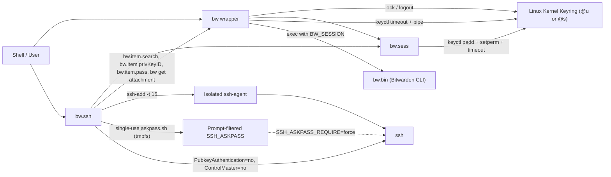

# bw_scripts

Bash scripts that extend the Bitwarden CLI (`bw`) with sessions in the Linux kernel keyring, vault item queries, SSH authentication, and Linux host provisioning.

## Overview

The [bw](bw) wrapper intercepts Bitwarden CLI commands and stores the session key in the Linux kernel keyring (`@u` by default, or `@s` through `BW_KEYRING`).
All terminals in the same keyring share one session key.
Each `bw` call resets the keyring timeout so the vault locks automatically after inactivity.



## Prerequisites

### Local Host

Install these tools on your local Linux host before you run the scripts:

| Tool | Requirement | Purpose |
| --- | --- | --- |
| `bash` | 4.4 or newer | Runs all scripts. |
| `bw.bin` | Official Bitwarden CLI | Runs the real CLI after you rename `bw` to `bw.bin`. |
| `keyctl` | `keyutils` package | Stores and expires the session key in `@u` or `@s`. |
| `jq` | Any current release | Parses and builds Bitwarden item JSON. |
| `ssh`, `ssh-add`, `ssh-agent`, `ssh-keygen` | OpenSSH 8.4 or newer | Runs `bw.ssh` (requires `SSH_ASKPASS_REQUIRE=force`) and generates keys in `bw.keysetup`. |
| `perl` | `libxcrypt` Yescrypt support | Generates Yescrypt (`$y$j9T$`) password hashes in `bw.keysetup`. |
| `date`, `stat`, `mktemp`, `install` | GNU coreutils | Parses ISO dates (`date --date`), checks mounts, creates temporary paths, and installs scripts. |
| `awk` | POSIX or GNU `awk` | Reads `ssh -G` output in `bw.ssh` and `bw.keysetup`. |

> [!IMPORTANT]
> Rename the official binary of the Bitwarden CLI from `bw` to `bw.bin` before you install these scripts.
> Never rename `bw` after you install the wrapper, or `bw.bin` will point to the wrapper script.

Use `sudo` when the official binary resides in a system directory such as `/usr/local/bin`:

```bash
bw_path="$(command -v bw)"
sudo mv "${bw_path}" "$(dirname "${bw_path}")/bw.bin"
```

> [!TIP]
> Package upgrades can restore `/usr/local/bin/bw` or delete a renamed binary.
> Instead of renaming the system file, point a symlink at `~/.local/bin/bw.bin` to the official binary.
> Put `~/.local/bin` before system directories in `PATH`.

Local runtime requirements:

- A Linux kernel with user (`@u`) or session (`@s`) keyring support.
- A writable `tmpfs` or `ramfs` directory (`$XDG_RUNTIME_DIR`, `/run/user/<uid>`, or `/dev/shm`) for temporary files in [bw.ssh](bw.ssh) and [bw.keysetup](bw.keysetup).
- `shellcheck` (optional) for static analysis during test runs.

### Remote Host (`bw.keysetup`)

Prepare these requirements on each Linux target before you run [bw.keysetup](bw.keysetup):

| Requirement | Details |
| --- | --- |
| Root SSH access | Plain `ssh` login as `root` with UID `0`. |
| Shells | `bash` for provisioning scripts and `/bin/sh` for user-scoped `authorized_keys` updates. |
| Init system | `systemd` with either `ssh.service` or `sshd.service`. |
| OpenSSH server | `sshd` supporting syntax checks (`sshd -t`) and effective configuration output (`sshd -T`). |
| User and file tools | `getent`, `useradd`, `chpasswd -e`, `id`, `stat`, `mktemp`, `cp`, `grep`, `awk`, `cut`, and `runuser` or `su`. |
| Yescrypt support | PAM and `libxcrypt` support for `$y$j9T$` hashes. [bw.keysetup](bw.keysetup) checks this with `perl`, `python3`, `/etc/shadow`, or `/etc/login.defs`. |
| SELinux (optional) | `restorecon`, which [bw.keysetup](bw.keysetup) runs on `~/.ssh` when present. |

## Installation

### Installer Script (Recommended)

Run [install.sh](install.sh) to check all 14 required host tools, including `ssh-agent` and GNU `date --date`.
The installer rejects `bw.bin` self-recursion and rejects symlinks on `--prefix`, ancestor directories, source scripts, and target paths.
It stages all 11 scripts in a temporary directory and replaces each file atomically with `mv -fT` (mode `0755`).

```bash
git clone https://github.com/neoautomata/bw_scripts.git
cd bw_scripts

# Check host prerequisites without installing files
./install.sh --check-only

# Install into ~/.local/bin
./install.sh

# Install into a custom directory
./install.sh --prefix /usr/local/bin
```

| Option | Behavior |
| --- | --- |
| `--prefix <dir>`, `--prefix=<dir>` | Installs all 11 scripts into `<dir>`. Rejects empty values, leading `-`, and symlinks. Default: `~/.local/bin`. |
| `--check-only` | Checks all required host tools, GNU `date --date`, and `bw.bin` recursion, then exits without copying files. |
| `--help`, `-h` | Prints usage text and exits `0`. |

Add the target directory to `PATH` if your shell does not already include it:

```bash
export PATH="${HOME}/.local/bin:${PATH}"
```

### Manual Installation

Create the target directory.
Copy all 11 scripts into it.
Mark the installed scripts executable.

```bash
mkdir -p "${HOME}/.local/bin"
cp bw bw.sess bw.item.* bw.ssh bw.keysetup "${HOME}/.local/bin/"
chmod 0755 "${HOME}/.local/bin/"bw "${HOME}/.local/bin/"bw.sess "${HOME}/.local/bin/"bw.item.* "${HOME}/.local/bin/"bw.ssh "${HOME}/.local/bin/"bw.keysetup
```

## Configuration

| Environment Variable | Default | Description |
| --- | --- | --- |
| `BW_SESSION_TIMEOUT` | `900` | Sliding timeout in seconds for the session key (`bw_session`). Accepts an integer from `1` to `86400` without leading zeros. [bw](bw) and [bw.sess](bw.sess) exit `1` for invalid values. |
| `BW_KEYRING` | `@u` | Target keyring in the Linux kernel. Accepts `@u` (permissions `0x3f3f0000`, possessor and owner UID) or `@s` (permissions `0x3f000000`, possessor only). [bw](bw) and [bw.sess](bw.sess) exit `1` for other values. |
| `XDG_RUNTIME_DIR` | `/run/user/<uid>` | RAM directory for temporary files in [bw.ssh](bw.ssh) and [bw.keysetup](bw.keysetup). Requires an absolute path, user ownership, non-symlink ancestors, and `tmpfs` or `ramfs`. When unset, scripts default to `/run/user/<uid>`. If the selected path fails checks, scripts use `/dev/shm` when root owns it, it has the sticky bit, and it mounts `tmpfs` or `ramfs`. |

> [!NOTE]
> [bw.sess](bw.sess) runs `bw.bin sync` after a fresh login or unlock when the last sync is older than 8 hours, missing, `null`, or unparseable.

## Vault Naming Conventions

[bw.ssh](bw.ssh) and [bw.keysetup](bw.keysetup) run `ssh -G` to resolve `<user>` (`user`) and `<host>` (`hostname`), then query vault objects by exact name:

| Vault Object | Convention | Details |
| --- | --- | --- |
| Login item `.name` | `<user>@<host>` | Must match one active Login item (`deletedDate == null`). |
| Private key attachment | Prefix `<user>@<host>`, not ending in `.pub` | [bw.ssh](bw.ssh) loads this key into an isolated `ssh-agent`. |
| Public key attachment | Prefix `<user>@<host>`, ending in `.pub` | [bw.keysetup](bw.keysetup) checks this key with `ssh-keygen -l` and installs it in `authorized_keys`. |
| Provisioned items | `root@<host>` and `jumper@<host>` | [bw.keysetup](bw.keysetup) creates or updates both Login items on each run. |
| Login password | 32 or more characters, no line breaks | [bw.keysetup](bw.keysetup) generates a 32-character password when the password is missing, shorter than 32 characters, or invalid. |
| Custom field `password_salt` | 32 to 64 characters (multiple of 4) in `[./0-9A-Za-z]` | [bw.keysetup](bw.keysetup) uses this salt for Yescrypt (`$y$j9T$`) hashes and regenerates it when the salt is missing or invalid. |
| Uploaded key filenames | `<user>@<host>` and `<user>@<host>.pub` | [bw.keysetup](bw.keysetup) generates `ed25519` keys and uploads the private key before the `.pub` file. |

## Script Reference

### Session and Wrapper Scripts

| Script | Usage | Description |
| --- | --- | --- |
| [bw](bw) | `bw [bw-args...]` | Scans global flags without altering arguments. Rejects `serve` with exit `1`. Bypasses [bw.sess](bw.sess) for zero arguments, `-h`/`--help`, `-v`/`--version`, explicit `--session`, and offline or authentication commands (`help`, `login`, `unlock`, `status`, `config`, `encode`, `generate`, `completion`, `update`). Revokes and unlinks the session key and unsets `BW_SESSION` on `lock` or `logout`. Blocks `bw.bin` self-recursion. |
| [bw.sess](bw.sess) | `bw.sess` | Checks an existing session key with `bw.bin unlock --check`, refreshes its timeout, and exits `0`. Revokes and unlinks stale keys. Runs `bw.bin login --raw` with isolated stdin when logged out (exit `1` on failure). Runs `bw.bin unlock --raw` when logged in (exit `2` on failure). Sets `0x3f3f0000` (`@u`) or `0x3f000000` (`@s`), sets the timeout, and syncs if stale. |

### Item Query Scripts

All `bw.item.*` scripts that accept `<itemID>` require a valid UUID and exit `1` otherwise.

| Script | Usage | Description |
| --- | --- | --- |
| [bw.item.get](bw.item.get) | `bw.item.get <itemID>` | Prints the full JSON object for `<itemID>`. |
| [bw.item.search](bw.item.search) | `bw.item.search <search>` | Searches active vault items (`deletedDate == null`) for an exact `.name` match and prints the single UUID. Lists all items when `<search>` starts with `>` to avoid Lunr query syntax. |
| [bw.item.pass](bw.item.pass) | `bw.item.pass <itemID>` | Prints the raw login password for `<itemID>`. Exits `2` when the password is missing or empty. |
| [bw.item.field](bw.item.field) | `bw.item.field <itemID> <fieldName>` | Prints the value of the single custom field named `<fieldName>`. |
| [bw.item.attachmentID](bw.item.attachmentID) | `bw.item.attachmentID <itemID> (--exact <name> \| --prefix <prefix> [--suffix <suffix> \| --exclude-suffix <suffix>]) [--label <label>]` | Matches attachments with parameterized `jq` filters and prints the attachment ID for a single match. |
| [bw.item.privKeyID](bw.item.privKeyID) | `bw.item.privKeyID <itemID> <keyPrefix>` | Finds the single attachment whose filename starts with `<keyPrefix>` and does not end with `.pub`. |
| [bw.item.pubKeyID](bw.item.pubKeyID) | `bw.item.pubKeyID <itemID> <keyPrefix>` | Finds the single attachment whose filename starts with `<keyPrefix>` and ends with `.pub`. |

### SSH, Provisioning, and Installer Scripts

| Script | Usage | Description |
| --- | --- | --- |
| [bw.ssh](bw.ssh) | `bw.ssh [ssh-options] <destination> [command]` | Forwards informational flags (`-V`, `-Q`, `-G`) directly to `ssh`. Resolves `<user>@<host>` with `ssh -G`. Uses an isolated `ssh-agent` (15-second TTL) when a private key exists, or atomic single-use `SSH_ASKPASS` in password mode. Rejects `ProxyJump` in password mode. |
| [bw.keysetup](bw.keysetup) | `bw.keysetup [ssh-options] root@<host>` | Runs a read-only pre-flight check on the remote host (root UID and Yescrypt support) before vault edits. Provisions `root@<host>` and `jumper@<host>`, Yescrypt passwords, `ed25519` keys, `authorized_keys`, and `PermitRootLogin prohibit-password`. |
| [install.sh](install.sh) | `install.sh [--prefix <dir>] [--check-only] [--help]` | Checks all 14 required host tools, rejects symlinks and `bw.bin` recursion, and replaces all 11 scripts atomically with mode `0755`. |

### Query Exit-Code Contract

[bw.item.search](bw.item.search), [bw.item.pass](bw.item.pass), [bw.item.field](bw.item.field), [bw.item.attachmentID](bw.item.attachmentID), [bw.item.privKeyID](bw.item.privKeyID), and [bw.item.pubKeyID](bw.item.pubKeyID) return deterministic exit codes so callers fail closed:

| Exit Code | Meaning |
| --- | --- |
| `0` | Finds 1 match and prints the result to stdout. |
| `1` | Reports a usage error, invalid UUID, missing tool, Bitwarden error, `jq` error, or invalid ID. |
| `2` | Finds 0 matches, or finds a missing or empty password in [bw.item.pass](bw.item.pass). |
| `3` | Finds more than 1 match (ambiguous result). [bw.item.pass](bw.item.pass) never returns `3`. |

## Usage Examples

### Run Bitwarden CLI Commands

Run `bw` directly without exporting `BW_SESSION` manually:

```bash
bw list items --search "GitHub"

# Revoke and unlink the session key
bw lock
```

### Query Vault Items, Fields, and Attachments

```bash
# Find an item ID by exact item name
item_id="$(bw.item.search "Cloudflare")"

# Read a custom field
bw.item.field "${item_id}" "api_key"

# Read the login password
bw.item.pass "${item_id}"

# Find an attachment ID by exact filename or prefix
bw.item.attachmentID "${item_id}" --exact "cert.pem"
bw.item.attachmentID "${item_id}" --prefix "prod-" --suffix ".crt" --label "Certificate"

# Find attachment IDs for SSH keys on a host item
host_id="$(bw.item.search "root@prod-01")"
bw.item.privKeyID "${host_id}" "root@prod-01"
bw.item.pubKeyID "${host_id}" "root@prod-01"
```

### Connect Over SSH

[bw.ssh](bw.ssh) parses your SSH configuration and arguments with `ssh -G` to resolve `<user>@<host>`:

```bash
# Authenticate using an isolated ssh-agent (15-second key TTL)
bw.ssh root@prod-01

# Pass standard SSH flags and a remote command
bw.ssh -p 2222 jumper@prod-01 uname -a
```

### Provision a Linux Host

> [!WARNING]
> [bw.keysetup](bw.keysetup) modifies `/etc/shadow`, creates the `jumper` user if absent, edits SSH daemon configuration, and reloads `ssh.service` or `sshd.service`.
> Test it against a non-production host first.

```bash
bw.keysetup root@prod-01
```

## Security Model

- **Session storage in the kernel keyring:** [bw.sess](bw.sess) writes the session key into `BW_KEYRING` via `keyctl padd` over stdin. It sets `0x3f3f0000` on `@u` (possessor and owner UID) or `0x3f000000` on `@s` (possessor only). Session keys stay in kernel memory and never touch disk or process arguments.
- **Sliding timeout and signal traps:** [bw](bw) resets the session key timeout to `BW_SESSION_TIMEOUT` (`1`–`86400`, default `900`) on each call. [bw.sess](bw.sess) revokes and unlinks stale keys on failed `unlock --check` and traps `EXIT`, `INT`, `TERM`, and `HUP` during setup.
- **Wrapper dispatch guards:** [bw](bw) revokes and unlinks the session key and unsets `BW_SESSION` before running `lock` or `logout`. It rejects `bw serve` and blocks `bw.bin` self-recursion through inode checks and `_BW_WRAPPER_ACTIVE`.
- **Isolated `ssh-agent`:** [bw.ssh](bw.ssh) starts an isolated `ssh-agent` per invocation and pipes the private key to `ssh-add -t 15 -`. It runs `ssh` without `exec` and stops the isolated `ssh-agent` on `EXIT`, `INT`, `TERM`, and `HUP`.
- **Single-use `SSH_ASKPASS` and temporary files in RAM:** [bw.ssh](bw.ssh) and [bw.keysetup](bw.keysetup) require a non-symlink `tmpfs` or `ramfs` directory and create temporary directories with mode `0700`. In password mode, [bw.ssh](bw.ssh) rejects `ProxyJump` and passes `PubkeyAuthentication=no`, `ControlMaster=no`, `ControlPersist=no`, and `ControlPath=none`. The single-use `askpass.sh` script with atomic consumption rejects `passphrase` or `key` prompts. It outputs the password once and deletes the password file. It forwards other prompts, such as host-key checks, to `/dev/tty` when available.
- **No secrets in `argv` or here-strings:** Scripts stream session keys, passwords, and salts through stdin pipes instead of command-line arguments or Bash `<<<` here-strings. [bw.keysetup](bw.keysetup) passes the password and salt to `perl` with NUL delimiters.
- **Fail-closed queries:** `bw.item.*` scripts require valid UUIDs, exact `.name` matches on active items (`deletedDate == null`), and parameterized `jq` filters. They exit `2` for 0 matches and `3` for multiple matches.
- **Pre-flight checks and rollback in `bw.keysetup`:** [bw.keysetup](bw.keysetup) runs a read-only pre-flight check on the remote host (root UID and Yescrypt support) before editing the vault. It rejects orphan `.pub` attachments, uploads the private key first, and deletes the private key if the `.pub` upload fails.
- **User-scoped `authorized_keys` updates:** [bw.keysetup](bw.keysetup) checks public keys with `ssh-keygen -l` and preserves trailing newlines in `authorized_keys`. For non-root users, it switches to the target user with `runuser` or `su`. It runs `restorecon` on `~/.ssh` when SELinux tools exist.
- **Atomic shadow and `sshd` edits:** [bw.keysetup](bw.keysetup) saves `mktemp` backups before editing `/etc/shadow` or `sshd_config`. It writes a mode `0600` drop-in or edits `sshd_config` atomically without changing prose comments. It checks configuration with `sshd -t` and dual-context `sshd -T`. On failure, it reverts the file and reloads `sshd` if a reload started.
- **Atomic installation:** [install.sh](install.sh) rejects symlinks on `--prefix`, ancestors, sources, and targets. It stages mode `0755` files in a temporary directory inside the target directory and replaces each script with `mv -fT`.

## Troubleshooting

| Symptom or Error | Cause | Fix |
| --- | --- | --- |
| `bw detected a recursive bw.bin call` or `bw.bin points to this bw script` | `bw.bin` resolves to the [bw](bw) wrapper script. | Point `bw.bin` to the official binary of the Bitwarden CLI. Reinstall [bw](bw). |
| [bw.ssh](bw.ssh) prompts interactively for a password instead of using Bitwarden | Local OpenSSH is older than 8.4 and ignores `SSH_ASKPASS_REQUIRE=force`. | Upgrade OpenSSH to 8.4 or newer, or store an SSH key pair in the vault item. |
| `Password authentication does not allow ProxyJump` | [bw.ssh](bw.ssh) rejects `ProxyJump` in password mode to avoid leaking credentials across hops. | Attach an SSH key pair to the vault item, or connect without `ProxyJump`. |
| `No writable RAM-backed runtime directory exists` | `$XDG_RUNTIME_DIR` (or `/run/user/<uid>` when unset) and `/dev/shm` failed symlink, ownership, sticky-bit, or `tmpfs`/`ramfs` checks. | Point `XDG_RUNTIME_DIR` to a user-owned `tmpfs` directory with non-symlink ancestors. Otherwise, check that `/dev/shm` mounts `tmpfs` with mode `1777` and root ownership. |
| `keyctl` fails with `Operation not permitted` or `Required key not available` | A container seccomp profile blocks keyring syscalls, or `@u` is unavailable. | Allow `add_key` and `keyctl` in the container profile. Alternatively, export `BW_KEYRING=@s`. |
| [bw.keysetup](bw.keysetup) fails during pre-flight or service reload | The remote host lacks Yescrypt support or does not manage OpenSSH with `systemd`. | Run [bw.keysetup](bw.keysetup) only against `systemd` hosts with Yescrypt PAM and `libxcrypt` support. |
| Session key does not share across terminals | `BW_KEYRING` uses `@s`, which scopes keys to one login session. | Use the default `BW_KEYRING=@u` to share one session key across all terminals for your UID. |

## Testing

Use [tests/run_tests.sh](tests/run_tests.sh) to run all test suites and `shellcheck` static analysis:

```bash
# Run all test suites and shellcheck
./tests/run_tests.sh

# Run test suites without shellcheck
./tests/run_tests.sh --no-shellcheck
```

<details>
<summary>Test suite inventory (6 suites, 160 tests, shellcheck checks 19 files)</summary>

| Suite | Tests | Coverage |
| --- | --- | --- |
| [tests/test_bw.sh](tests/test_bw.sh) | 25 | `BW_SESSION_TIMEOUT` (`1`–`86400`), `BW_KEYRING` (`@u`/`@s`), `lock`/`logout` revocation, bypass commands, `bw serve` rejection, self-recursion guard, and retry logic. |
| [tests/test_bw_items.sh](tests/test_bw_items.sh) | 24 | UUID checks, `bw.item.pass` exit codes, exact active-item search (`deletedDate == null`), list mode for leading `>`, parameterized `bw.item.attachmentID` flags, and exit codes `0`–`3`. |
| [tests/test_bw_keysetup.sh](tests/test_bw_keysetup.sh) | 36 | Remote pre-flight checks, salt checks, NUL-delimited `perl` hashing, partial upload rollback, `mktemp` shadow rollback, `ssh-keygen -l` checks, user-scoped `authorized_keys`, and `sshd -T` checks. |
| [tests/test_bw_sess.sh](tests/test_bw_sess.sh) | 33 | Existing session reuse, `login --raw` flow, stdin isolation, stale key revocation, `0x3f3f0000` (`@u`) and `0x3f000000` (`@s`) permissions, signal traps, and 8-hour sync boundaries. |
| [tests/test_bw_ssh.sh](tests/test_bw_ssh.sh) | 27 | Informational flag forwarding, isolated `ssh-agent` lifecycle, `tmpfs`/`ramfs` and symlink checks, `ProxyJump` rejection, atomic single-use `SSH_ASKPASS`, `/dev/tty` delegation, and fail-closed exits. |
| [tests/test_install.sh](tests/test_install.sh) | 15 | `--prefix` checks, GNU `date` check, `bw.bin` recursion guard, symlink rejection, atomic staging, `--check-only`, file permissions, and signal traps. |

</details>

## License

This project uses the MIT License.
Read [LICENSE](LICENSE) for the full text.
